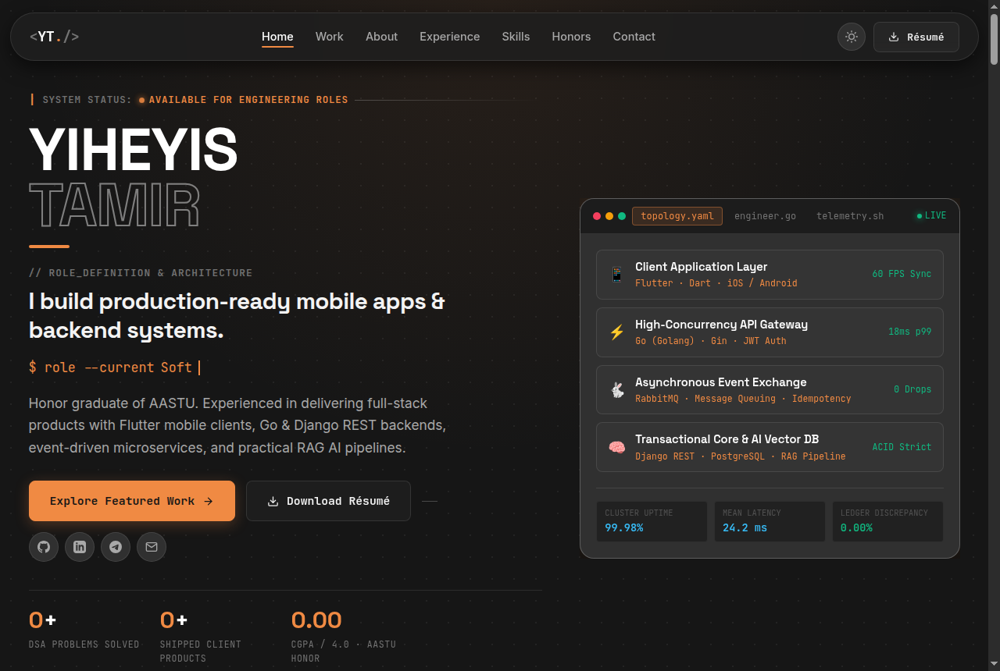
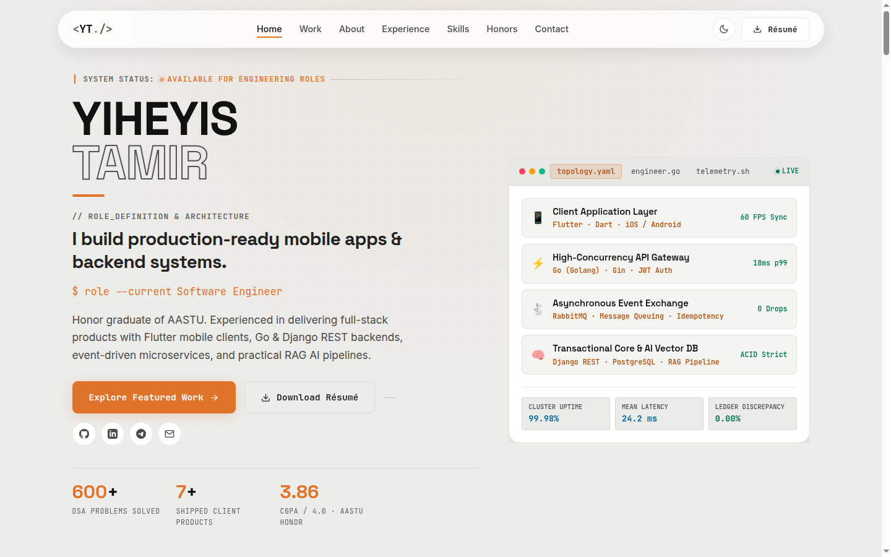
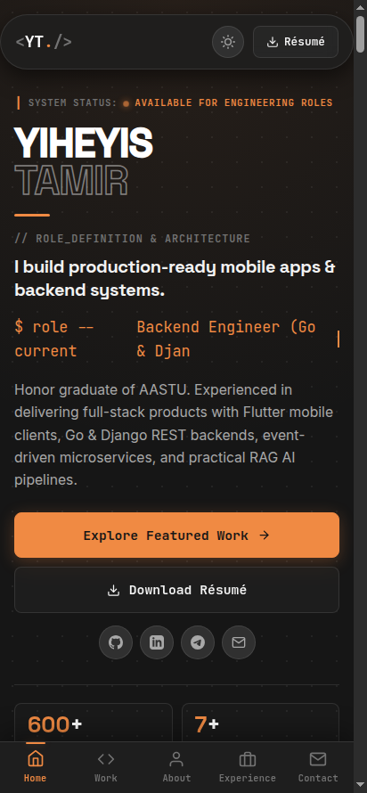
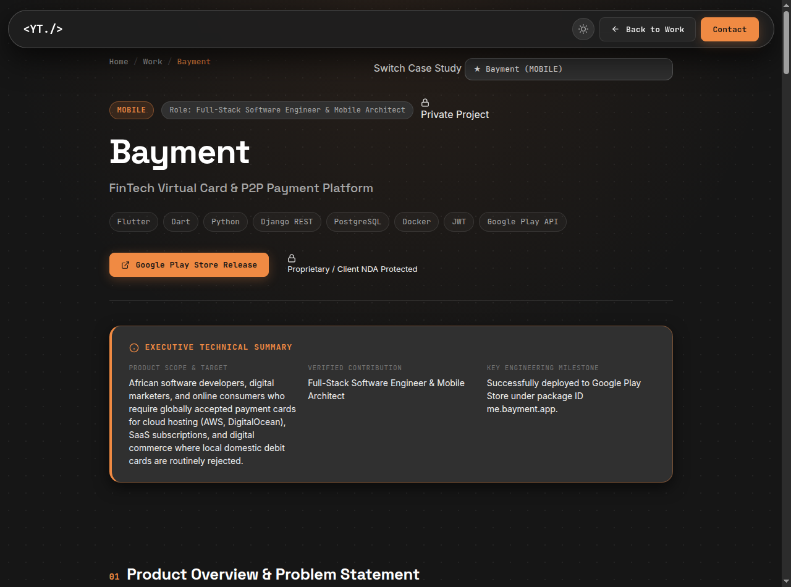
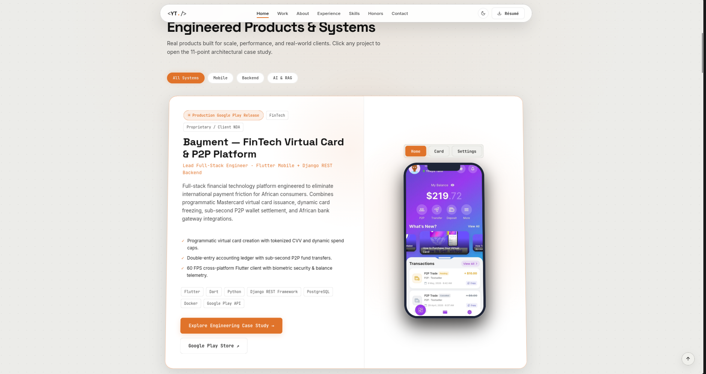

<div align="center">

# Yiheyis Tamir Ayalew — Software Engineer Portfolio

**Mobile Application Engineer (Flutter) · Distributed Systems & Backend (Go, Django) · Applied AI (RAG)**

[](https://yiheyis-tamir.tech)
[](LICENSE)
[](https://vite.dev)
[](https://t.me/yiheyis_contact_bot)

<br/>

> *"I build mobile applications & backend systems that power real products."*


<br/>

</div>

---

## 📸 Visual Showcase

### Desktop Experience (Dual Theme System)

| Dark Theme (Default) | Light Theme (Warm Paper) |
| :---: | :---: |
|  |  |

---

### Mobile-First Layout & In-Depth Case Studies

| Mobile Experience (Bottom Nav Bar) | 11-Point Architectural Case Study |
| :---: | :---: |
|  |  |

---

### Featured Production Systems & Flagships



---

## ⚡ Key Highlights & Architecture

- **Mobile-First Bottom Navigation Bar**: Custom thumb-zone bottom navigation bar on mobile with smart auto-hide on downward scroll and instant reveal on upward scroll.
- **Ambient Cursor Glow & Card Spotlight**: Hardware-accelerated GPU follower (`requestAnimationFrame` + lerp) providing subtle ambient glow and interactive card illumination (Linear/Raycast style), auto-disabled on touch devices for zero battery drain.
- **Dedicated Architectural Case Studies (`project-detail.html`)**: Deep 11-point engineering breakdowns covering technical architecture, personal contributions, engineering trade-offs, and verified outcomes for all 15 systems.
- **Instant Telegram Bot Notification Pipeline**: Every inquiry submitted through the contact form triggers an instant, formatted push notification directly to Telegram via a dedicated private bot, backed up by Formspree fail-safe.
- **Zero Heavy Runtime Frameworks**: Built with vanilla ES2022 JavaScript modules and modern CSS custom properties bundled with Vite. Extremely fast sub-second load times and high performance.
- **Dual Theme Support**: Persistent Dark & Light modes with automatic OS system preference detection (`prefers-color-scheme`) and no flash of incorrect theme (FOIT).

---

## 🛠️ Technology Stack

| Layer | Technologies |
| :--- | :--- |
| **Mobile** | Flutter, Dart, Riverpod, BLoC, iOS & Android Native APIs, Biometrics, Google Maps SDK |
| **Backend & Microservices** | Go (Golang), Gin Framework, Python, Django REST Framework, FastAPI, RESTful APIs, JWT Auth |
| **Data & Queues** | PostgreSQL, TimescaleDB, Redis, RabbitMQ, Docker & Docker Compose, Linux |
| **Applied AI & RAG** | Retrieval-Augmented Generation, Dense Vector Embeddings, BM25 Lexical Search, Ethiopic NLP, OCR Computer Vision |
| **Frontend & Tooling** | Vanilla ES2022 Modules, Modern CSS3 Custom Properties, Vite 6, Telegram Bot API, Formspree |

---

## 📁 Repository Structure

```
Yiheyis-portfolio/
├── api/
│   └── contact.js                 # Serverless API endpoint for Telegram relay (Vercel/Netlify)
├── docs/
│   └── screenshots/               # High-resolution showcase screenshots
│       ├── hero-dark.png
│       ├── hero-light.png
│       ├── mobile-view.png
│       ├── featured-work.png
│       └── case-study.png
├── public/
│   ├── favicon.svg                # Vector site icon
│   ├── robots.txt                 # Search engine directives
│   ├── sitemap.xml                # SEO sitemap
│   ├── Yiheyis-Tamir-Ayalew-Resume.pdf  # Downloadable PDF résumé
│   └── images/                    # Project screenshot assets & photography
│       ├── p1.jpg
│       ├── certificate-1.png
│       └── projects/              # Verified production app screenshots
├── src/
│   ├── css/
│   │   └── styles.css             # Unified design system & responsive layout
│   └── js/
│       ├── main.js                # Core SPA entry point & interaction orchestration
│       ├── project-detail.js      # Case study renderer & interactive simulators
│       └── projects-data.js       # Verified 15-project data registry & case studies
├── index.html                     # Primary portfolio document
├── project-detail.html            # Dedicated deep-dive case study page
├── package.json                   # Dependencies and scripts
├── vite.config.js                 # Multi-page Vite bundler config
└── README.md                      # Project documentation
```

---

## 🚀 Quickstart & Local Development

### Prerequisites

- [Node.js](https://nodejs.org/) (v18 or higher)
- npm (v9 or higher)

### Setup

```bash
# 1. Clone repository
git clone https://github.com/Yiheyistm/Yiheyis-portfolio.git
cd Yiheyis-portfolio

# 2. Install dependencies
npm install

# 3. Configure environment variables (optional for Telegram notifications)
cp .env.example .env

# 4. Start local development server with Hot Module Replacement (HMR)
npm run dev
```

Visit `http://localhost:5173` in your browser.

---

## 📦 Production Build

```bash
# Compile and optimize assets into dist/
npm run build

# Preview production build locally
npm run preview
```

---

## 🔔 Telegram Bot Setup (Optional)

To enable instant phone notifications for the contact form:

1. Chat with [@BotFather](https://t.me/BotFather) on Telegram and create a bot (`/newbot`) to get a **Bot Token**.
2. Open your new bot and press **START**.
3. Retrieve your **Chat ID** from [@userinfobot](https://t.me/userinfobot).
4. Add them to your `.env` file:

```env
VITE_TELEGRAM_BOT_TOKEN=your_bot_token_here
VITE_TELEGRAM_CHAT_ID=your_chat_id_here
```

When deployed to Vercel or Netlify, add `TELEGRAM_BOT_TOKEN` and `TELEGRAM_CHAT_ID` as environment variables in your project dashboard for server-side token cloaking via [`api/contact.js`](api/contact.js).

---

## 🌐 Deployment

This project builds static output into the `dist/` directory and can be deployed anywhere:

- **Vercel**: Pre-configured with automatic Vite build detection and serverless function support in `api/`.
- **Netlify**: Set build command to `npm run build` and publish directory to `dist/`.
- **GitHub Pages / Cloudflare Pages**: Deploy the `dist/` directory directly.

---

## 📬 Contact & Connect

- **Email**: [yiheyisyt23@gmail.com](mailto:yiheyisyt23@gmail.com)
- **Telegram**: [@Abetobr](https://t.me/Abetobr)
- **LinkedIn**: [linkedin.com/in/yiheyis-tamir-b56aa8300](https://linkedin.com/in/yiheyis-tamir-b56aa8300)
- **GitHub**: [github.com/Yiheyistm](https://github.com/Yiheyistm)
- **Website**: [https://yiheyis-tamir.tech](https://yiheyis-tamir.tech)

---

## 📄 License

This project is licensed under the MIT License — see the [LICENSE](LICENSE) file for details.
